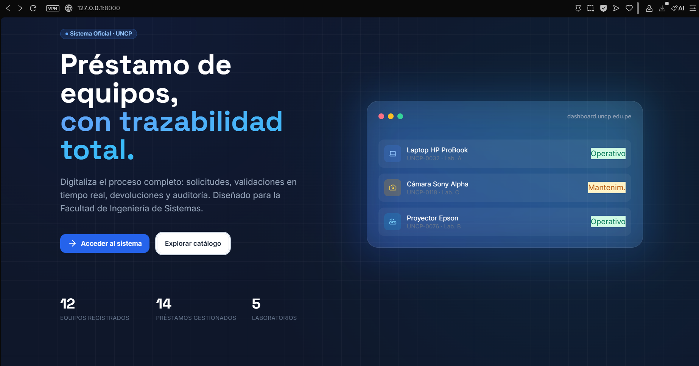
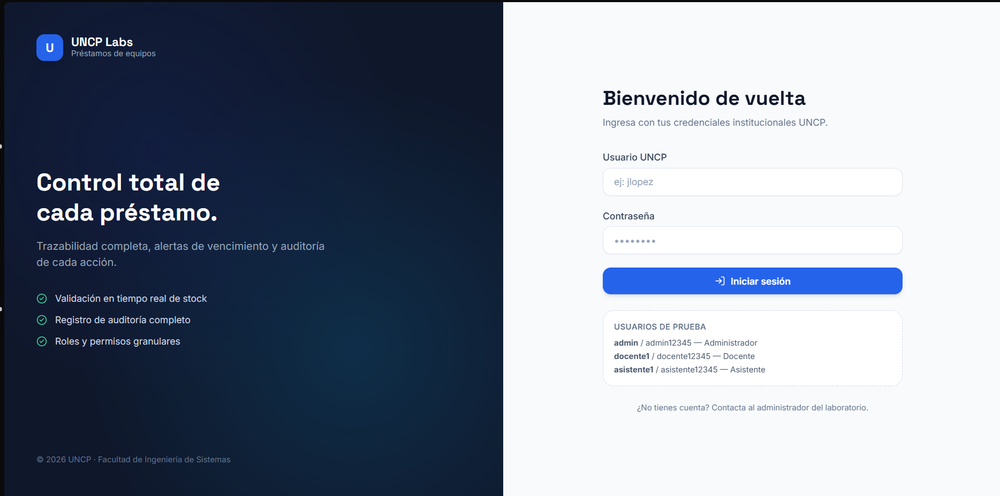
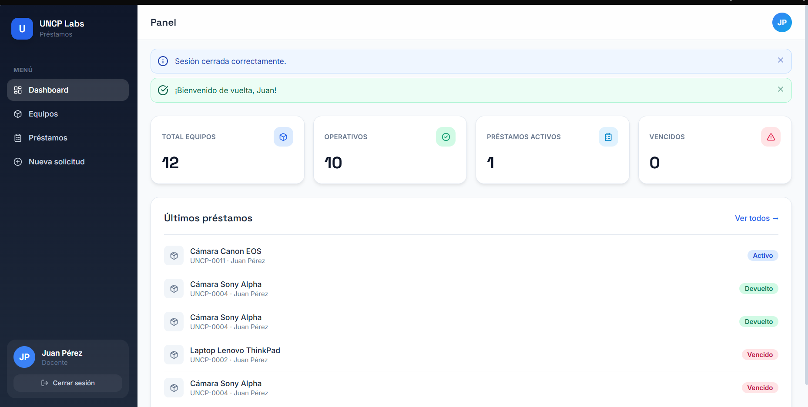
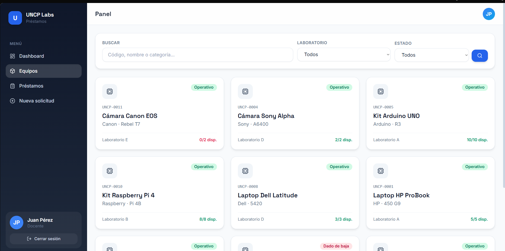
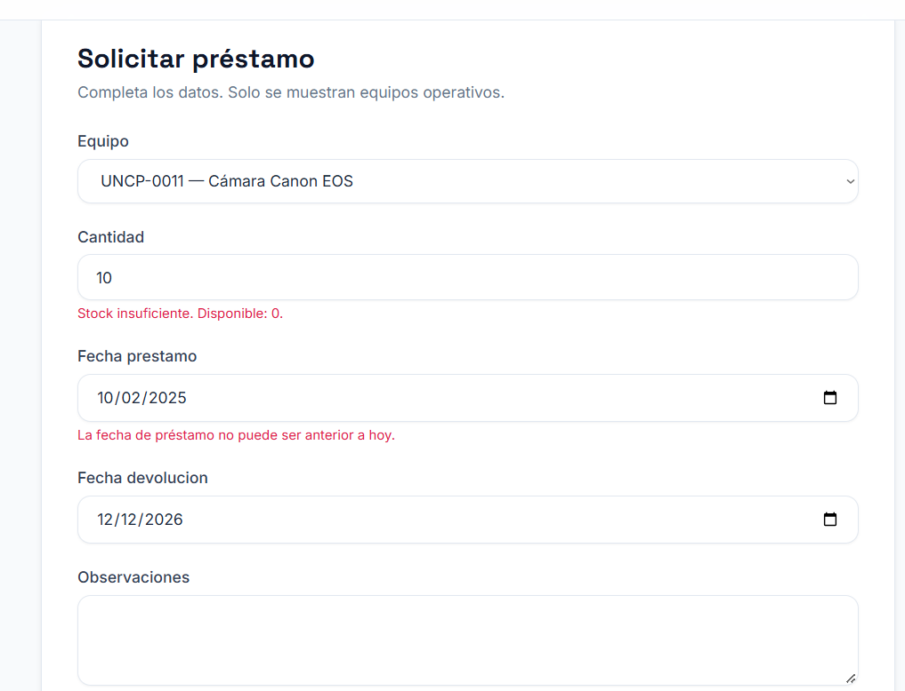

# 🎓 UNCP Labs — Sistema de Gestión de Préstamos de Equipos

Sistema web fullstack para la **gestión digital de préstamos de equipos de laboratorio** de la Facultad de Ingeniería de Sistemas de la **Universidad Nacional del Centro del Perú (UNCP)**.

Reemplaza el registro manual en cuadernos físicos con una plataforma segura, auditable y con trazabilidad completa.

---

##  Capturas

### Landing page

### Login institucional

### Dashboard

### Catálogo de equipos

### Formulario de préstamo — caso válido

### Formulario de préstamo — caso inválido (validaciones cruzadas)

### Django Admin — acciones masivas

### Middleware en acción (logs en consola)

### Cookies de sesión en DevTools (HttpOnly + timeout 30 min)

### Vista protegida (docente solo ve sus préstamos)

---

##  Arquitectura

